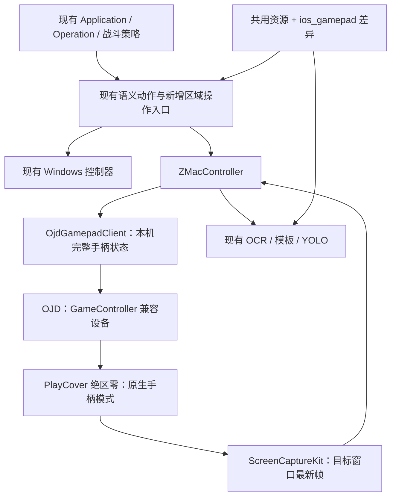

# macOS 增量迁移代码方案

状态：当前桌面、默认调查专项的单次实战模拟室完整自动流程已通过，包含导航、出战、战斗、结算和返回大世界；GUI 热切换与默认已保存账号的完整冷启动均已实机通过，原体力计划已接入；七项日常任务仍在推进，不能视为全项目迁移完成。各项是否通过见 [实施进度](macos_migration_progress.md)。日期：2026-10-25。代码基线：`8fe22ef0cf127f596ba6b28047416fb68dacc797`。以下接口与阶段描述是设计，不表示已经全部实现。

已完成仓库准备：[Aurxs fork](https://github.com/Aurxs/ZenlessZoneZero-OneDragon) 已创建；本地工作目录保持不变，`origin` 指向 fork，`upstream` 指向 [原仓库](https://github.com/OneDragon-Anything/ZenlessZoneZero-OneDragon)，主仓与测试仓均已创建 `codex/macos-migration` 分支。未删除原目录、配置或资源。按用户授权，将完成并验证的组件在主仓与测试仓配对提交 checkpoint。

近期手柄项目的版本、源码证据和限制集中记录在 [macOS 原生手柄方案调研](macos_gamepad_research.md)，本文不重复展开项目调查。

## 当前结果与下一步

`tools/macos/run_combat_simulation.py` 已在当前桌面完成一次默认调查专项：HIA 大世界 → 自动手册导航 → 方案页 → 出战 → 战斗 → 挑战结果 → B 完成 → 方案页 B → 材料分类 B → 大世界。运行于 2026-10-25 15:43:22—15:44:16，退出码 0，返回 `success=true`、`completed_battles=1`；期间没有 CUA 动作或人工按键，仅在结束后截图观察确认大世界。该单次使用最后 100 电量，结束余量没有另开手册复核，不写精确剩余值。

这次已通过完整 Operation，范围是当前手柄模式、默认调查专项五卡和当前队伍。此前调试因结算残留 X 连续挑战，电量 400→100 的事实仍保留在 [实施进度](macos_migration_progress.md)，不与本次受控单次验收混为一谈。

原 GUI 的热切换与默认账号冷启动均已通过，精确日志见实施进度。已是手柄时跳过鼠标；触屏阶段使用必要前台点击，结束后按用户是否主动改动的条件恢复鼠标和原前台应用。

下一阶段：

- 复用已通过的冷启动准备；凭据、验证码和登录奖励等其它分支按实际出现再补，CUA 不成为最终运行依赖。
- 保留原 GUI、任务列表和体力计划配置，未适配项灰显。继续验证原任务入口与生命周期；优先迁移每日签到、录像店、咖啡、体力计划、活跃度奖励、丽都周纪和丽都城募。
- 逐步覆盖更多预设、队伍、重复策略、资源不足和失败退出等分支，不把单次调查专项通过外推到全部应用。
- 保持 Windows、OJD 和 HID 底层输入不变，仅新增兼容与启动适配层。跨桌面 / Space 采集继续列未来计划，不纳入本轮排查。

## 1. 目标与首版范围

- 游戏通过 PlayCover 运行，自动任务使用原生手柄界面。启动时由一条龙检测输入模式、按需完成必要点击并切入手柄，再以截图确认；不开发完整触屏版任务流程。
- 自动运行优先使用后台手柄，让用户能在其他应用正常打字和使用鼠标。用户后续明确允许首次登录、切换输入类型及确实无法用手柄完成的环节使用必要点击；逐处标注点击是否需要前台，不把反复抢焦点当作默认后台控制。
- 开发机为 M3 Max / 36GB / macOS 26.7。目标验证档位为 M3 及以上 / 16GB；8GB 或 M2 及以下尽力支持，不预先承诺性能。
- 游戏可玩、Xbox 兼容蓝牙手柄可用是用户已验证的前提；具体是否 Xbox 360 协议、失焦后行为尚未核实。
- 先跑通源码和一个真实任务闭环，再扩展其余一条龙应用、优化推理和制作安装包。首个闭环为体力计划中的实战模拟室。
- 最终由一条龙完成启动前置和后续任务：检测输入模式、按需切入手柄并截图确认，再打开手册、选副本、选编队、战斗、结算、重复和返回大世界。当前冷启动已覆盖默认已保存账号；完整触屏流程、全部日常和多账号后续逐步覆盖。
- CUA 仅用于开发观察，不参与最终运行。不能要求用户每次手动点设置或切手柄；必要前台启动步骤须明确记录，不能默默变成全程抢键鼠。
- 当前桌面的默认调查专项单次流程已通过；后台范围仍仅按窗口打开、同桌面非前台逐项确认。跨 Space 采集列入后续计划，不在本轮扩大验证；最小化、锁屏和睡眠也不得统称为已支持后台。

只有实际完成验证的应用才能标为可用。项目最终迁移目标仍是完整一条龙；实战模拟室通过不代表其余应用自动兼容。

## 2. 核心决策

**用户确认的架构边界：不修改已有底层输入代码。迁移通过新增手柄输入抽象和平台兼容层完成，不重写 Windows Xbox/DS4 按钮实现，不修改 OJD 或其 HID 驱动。** 上层统一表达按键、摇杆、扳机和释放；平台适配器把这些动作转换为现有服务支持的调用。

1. 保留上游 Application / Operation、计划计算、运行记录、战斗 YAML 和动作名称。平台判断集中在少数构造和服务入口。
2. 新 Mac 控制器直接基于 `ControllerBase`，不继承仍含 WinAPI 的 `PcControllerBase` 或 `ZPcController`。
3. 输入使用 **手柄抽象 + OJD 适配器**。CLI 持久连接已完成游戏基础响应验证，首个开发版本复用此路径；Unix socket 后续确有收益时再接入，不先增加新授权链，不自研虚拟 HID。
4. 截图使用 **PyObjC + ScreenCaptureKit**，只采集绑定的游戏窗口，并返回帧实际采集时间。需要时才把采集内部换为 Swift helper。
5. 原生手柄菜单按具体画面开发导航操作；不存在可靠的通用“坐标点击转方向键”转换。必要点击做显式、有限的补充步骤，不自动回退到任意键鼠操作。
6. 系统差异与客户端画面差异分开：Mac 系统实现负责窗口/输入；`ios_gamepad` 资源配置负责游戏区域、模板和导航差异。
7. 推理先使用 CPU 作为正确性基线，保留 ONNX 模型；再按模型验证 Core ML，不同时重写识别框架。

移动端切入手柄模式后触屏失效。启动交互层负责检测模式、在切换前执行必要点击、切入手柄并截图确认，然后交给手柄任务；这些步骤由一条龙自动完成。若后续流程确需触屏，应显式切换输入模式并恢复，记录焦点影响，不能把 Windows 手柄/鼠标混用方案直接移植。



## 3. P0：先证明输入与后台链路

先完成这一阶段，再进入大规模菜单和界面迁移。所有结果记录系统、游戏、PlayCover、PlayTools、OJD 版本。另分开验证“启动前连接手柄”“进入游戏后切换输入类型”“退出后是否记住手柄模式”。已实机确认登录前设置可打开；具体结果见进度文档。

| 顺序 | 验证内容 | 通过条件 |
|---|---|---|
| 1 | 已有实体手柄失焦操作 | 切到编辑器后，游戏仍接收移动、攻击和菜单输入；记录是否继续渲染 |
| 2 | OJD 固定版本发行包 | 核验签名和虚拟 HID entitlement，在正常系统保护下创建独立虚拟手柄 |
| 3 | GameController 识别 | 不只检查 `hidutil`；观察控制器枚举与按钮、两根摇杆、扳机数值 |
| 4 | 游戏原生手柄输入 | 游戏保持手柄界面，接受点按、长按、组合输入、移动与攻击同时保持 |
| 5 | 游戏失焦与用户操作 | 脚本运行时用户正常打字/移动鼠标，前台应用和桌面鼠标位置不被脚本改变 |
| 6 | 截图与输入闭环 | 遮挡后仍采到更新帧；窗口关闭、采集停止、输入断开时停止动作并释放状态 |

已新增独立探测入口 `tools/macos/gamepad_probe.py`，不导入 `ZContext`，避免把依赖移植阻塞与设备兼容问题混在一起。它只发送明确选择的测试动作、记录响应和执行释放；输入验证不能冒充完整流程测试。

OJD 首选失败时，按调研文档评估 libvirtualhid；只有外部服务均不能满足要求时，才另做 PlayTools 原生手柄桥接或硬件方案评估。任何候选都不能因为只能发键鼠/触屏就悄悄降低首版目标。需要改变系统保护的方案不作为默认发行前提。

系统级虚拟手柄不保证事件仅进入一个游戏。首版要求同时不运行另一个接收手柄输入的游戏；这不影响普通键盘鼠标办公，但须在验收中区分这两个边界。

## 4. P1：依赖、导入与源码启动

当前已实现 Mac 源码入口：在项目根目录执行 `PYTHONPATH=src uv run --no-sync python -m zzz_od.macos.main`。Mac 重启沿用当前 Python，启动时跳过 Windows launcher 更新，保留模型检查。游戏设置页的显式平台配置不会转换旧 PC 实例；修改平台、bundle ID 或 OJD 路径后会暂停、清理旧服务并要求重启。

`game_session_entry` 已供 `ZApplication` / `ZOperation` / `ZOneDragonApp` 共用，Mac 已支持默认已保存账号的冷启动与已登录会话准备，不导入 Windows 登录流程，恢复时不激活窗口。原一条龙保留任务列表和顺序，运行前检查适配范围。初始化失败通过 `initialization_error` 返回，不发送 ready，也不等待运行超时。

原生 Cocoa 下完整 `AppWindow` 的 9 个页面已构造成功；offscreen 构造完整窗口时第三方 `qframelesswindow` 会发生原生段错误，不能据此判定 Mac 实际窗口失败。Mac 实例 02 已创建并选中，PC 实例 01 保留；OCR ppocrv6 与 flash 模型已下载，真实上下文初始化约 1.259 秒且 `ready=true`，截图 OCR 识别到“点击进入游戏”，flash CPU 初始化成功。Mac 音频路径已隔离并有 2 项聚焦测试通过。GUI 冷热启动准备已通过，更多完整应用流程仍待联调。以下保留各项实现落点及后续检查范围。

### 4.1 Python 环境

修改 [pyproject.toml](../../../pyproject.toml) 和生成的 `uv.lock`，继续使用 Python 3.11 与一个统一锁文件：

- `pywin32`、`onnxruntime-directml`、`pyuac`、`vgamepad` 添加 `win32` 条件。
- `darwin` 使用 `onnxruntime`，优先匹配现有 ORT 版本；实际 arm64 wheel 不可用时再选择兼容版本并说明原因。
- Mac 添加 `pyobjc-framework-ScreenCaptureKit` 以及实现直接使用的最少框架绑定；版本经安装验证后锁定。
- 公共路径先隔离 `pynput` / `pyautogui` 的导入，再将不需要的 Mac 依赖排除。不能仅改依赖声明却保留顶层导入。
- 声音闪避首版关闭，并隔离 Windows `soundcard.mediafoundation` 导入。
- uv 支持范围增加 Darwin arm64，保留 Windows。锁文件由 `uv lock` 生成；不手改 wheel URL，不另维护长期分叉的 Mac requirements。

首次实现时在 Mac 和 Windows 各做一次锁定依赖安装；以后仅在相关依赖变化时重复。[uv 平台解析说明](https://docs.astral.sh/uv/concepts/resolution/)

### 4.2 导入阻塞与落点

以下列出实现落点，相对项目根目录；具体已完成项与待检查项以实施进度为准：

| 路径 | 改动 |
|---|---|
| `src/one_dragon/utils/debug_utils.py` | 移除顶层 Win32 剪贴板导入，通用图片保存不依赖 Windows；剪贴板按平台延迟调用 |
| `src/one_dragon/base/operation/one_dragon_context.py` | Mac 不创建 Windows 按键监听与全局键鼠控制器；调试截图不再直接调用 `game_win.active()` |
| `src/one_dragon/base/controller/gamepad_button.py`（新增） | 新兼容层使用无平台依赖的配置按键数据，`GameConfig` 不再为读配置导入设备实现；已有 Xbox/DS4 实现文件保持原样 |
| `src/zzz_od/gui/app.py` | 在导入前判断悬浮窗/画中画等能力；错误提示使用 stderr / Qt，不调用 Windows MessageBox |
| `src/one_dragon_qt/widgets/setting_card/key_setting_card.py` | 按键监听延迟到实际录制入口；Mac 设置页使用手柄按键选择，不因顶层 `PcButtonListener` 再次引入键鼠依赖 |
| `src/zzz_od/operation/turning/turn_compensation.py` 及相关工厂导入链 | 将仅作类型注解的 `ZPcController` 导入隔离到 `TYPE_CHECKING`；平台实现延迟到创建应用/控制器时导入 |
| `src/one_dragon/utils/cmd_utils.py` | Windows 专用 subprocess flags 只在 Windows 构造，保留现有返回值和日志 |
| `src/one_dragon/utils/app_utils.py` | Mac 重启使用当前 Python 和 Mac 源码入口，不查找 `.exe` |
| `src/one_dragon_qt/view/setting/setting_custom_interface.py` | 用 Qt 标准目录或宿主实现获取图片目录，不直接调用 shell32 |
| `src/zzz_od/macos/main.py`（新增） | Darwin/arm64 源码入口，调用公共 GUI 初始化，不经过 pyuac、Windows 安装器或 RuntimeLauncher |

只对确实需要分支的宿主操作新增 `src/one_dragon/platform/host_services.py` 及 Windows/Mac 实现：子进程选项、重启命令、能力开关。图片目录优先直接用 Qt `QStandardPaths`；不要为每个标准库操作新增抽象。

GUI 首版复用现有 Fluent 页面，隐藏尚未支持的悬浮窗、画中画、声音闪避、Windows 驱动安装、启动器升级及电源操作。开始/停止使用 GUI 控件；全局停止快捷键若后续添加，应为独立监听能力，不能成为键鼠注入的入口。

应用发现会导入全部工厂；咖啡、录像店和锄大地等可经转向模块间接导入 Windows 控制器。P1 验证须覆盖设置页导入及工厂发现，不只导入 `ZContext`。优先隔离纯类型引用和延迟设备实现导入；确实无法隔离的工厂在导入前筛选。运行支持清单和 GUI 隐藏不能替代这一步。

## 5. P2：Mac 控制器、输入与截图

### 5.1 文件与职责

| 路径（基本实现已存在，剩余接入见实施进度） | 职责 |
|---|---|
| `src/zzz_od/controller/zzz_macos_controller.py` | `ZMacController(ControllerBase)`；组合输入、窗口采集、当前配置；提供现有战斗动作方法 |
| `src/one_dragon/base/controller/gamepad_input.py` | 新增纯平台无关手柄输入接口与状态定义，描述按键/摇杆/扳机/释放，不导入设备库 |
| `src/one_dragon/base/controller/macos/ojd_gamepad_client.py` | `OjdGamepadClient`；封装固定版本 feed/socket 协议、状态更新、停止与断线清理 |
| `src/one_dragon/base/controller/macos/macos_window_capture.py` | `MacWindowCapture`；枚举窗口、绑定采集、最新帧、停止 |
| `src/one_dragon/base/controller/macos/sck_frame_converter.py` | 处理内容区、像素格式、Retina 点/像素与 1080p 输出 |
| `src/zzz_od/config/macos_config.py` | 实例级 `MacOsConfig`，采用 `YamlConfig` |
| `src/one_dragon/base/config/game_account_config.py` | 增加 `macos_playcover` 平台值，原 PC 配置兼容 |
| `src/zzz_od/context/zzz_context.py` | 按配置延迟构造控制器；移除实例切换对 `ZPcController` 的硬限制；刷新平台资源 |
| `src/one_dragon/base/controller/controller_base.py` | 沿用现有接口；Mac 覆盖 `screenshot()` 返回实际采集时间，Windows 默认行为保持原样 |
| `src/one_dragon/base/operation/operation.py` | `check_game_window()` 使用公共窗口描述，窗口未打开时正常返回失败，不访问 Mac 不存在的 `game_win.win_title` |

`MacOsConfig` 当前包含：`bundle_id`、可选 `window_title`、`ojd_cli_path`、`resource_profile`、`capture_fps`、`max_frame_age_seconds`、镜头校准参数，以及默认 0 的 `capture_top_inset_pixels`，显式配置顶部裁剪。当前仅接持久 CLI，未增加 socket 配置；`resource_profile` 的资源覆盖留待 P3 接入。bundle ID 从本机确认；PID/window ID 仅存在运行时，不长期存入配置。系统通过 `sys.platform` 判断，客户端通过 `macos_playcover` 判断，画面通过 `ios_gamepad` profile 判断，不混用三个维度。

`ZMacController` 已提供只读 `game_window_description: str`，返回目标应用/窗口描述。公共窗口检查兼容该说明及原 Windows 窗口标题，不给 Mac 伪造 `PcGameWindow`。其余直接访问 `game_win` 的调用随首批应用接入逐项替换。

### 5.2 输入接口与行为

以下为设计签名，不是已实现 API：

```python
class OjdGamepadClient:
    def connect(self) -> None: ...
    def tap(self, key: str) -> None: ...
    def press(self, key: str, press_time: float | None = None) -> None: ...
    def release(self, key: str) -> None: ...
    def set_stick(self, stick: Literal['left', 'right'], x: float, y: float) -> None: ...
    def reset(self) -> None: ...
    def close(self) -> None: ...
```

- 客户端维护按钮、扳机、左右摇杆的完整状态；按键变更在锁内合并，由单一发送者提交，避免移动与攻击互相覆盖。
- 保留现有 `press/release/press_time` 行为和组合操作的逆序释放。使用持续连接，不为每个动作执行 CLI。
- 第一个 OJD 适配器复用已实测的持久 CLI feed；统一手柄接口不暴露 CLI/IPC 细节。服务未启动、版本/协议不匹配时明确失败，不能回退键鼠。
- Unix socket 作为后续可替换 transport，启用时另处理 endpoint 的 `Control` 权限和 token challenge；不在首个版本增加尚未必要的凭据。采用时凭据存本机凭据存储，不进入 YAML、日志或仓库，授权撤销即停止。
- 暂停、停止、窗口消失、采集过期、断连、异常退出和配置切换都清空状态。断线重连从中立开始，不重放旧动作。服务端断连清理是进程异常终止时的必要补充。
- 长按刷新和动作期限使用单调时钟；限制发送队列长度，停止优先于未发送动作，避免排队很久后继续攻击。
- `ZMacController` 保留 `dodge/normal_attack/switch_next/move_w/...` 名称，第一版用薄封装复用 `GameConfig` 的 Xbox 动作映射；不为共享少量包装方法大改 Windows 继承树。
- `turn_by_distance` 等镜头接口在 Mac 转为右摇杆时长/强度，并单独校准。旧 Windows 鼠标距离和手柄转速不能直接当作 Mac 实测值。
- 初始控制器的 `click` 只有明确的 `gamepad_key` 时可执行对应动作；纯坐标点击先返回未支持。用户已允许的必要点击后续通过单独的、已建档的步骤接入，明确坐标来源和焦点影响；不把所有未支持动作自动转换成桌面输入。拖拽、文本、滚轮未实现时明确终止，不保留空实现假成功。

### 5.3 截图接口与时间

```python
class MacWindowCapture:
    def list_windows(self, bundle_id: str) -> list[MacWindow]: ...
    def start(self, window: MacWindow, *, fps: int = 30) -> None: ...
    def latest_frame(self, *, max_age_seconds: float) -> CapturedFrame | None: ...
    def stop(self) -> None: ...

# ZMacController 覆盖现有接口，Windows 保持原逻辑。
def screenshot(self, independent: bool = False) -> tuple[float, MatLike | None]: ...
```

`CapturedFrame` 保存 RGB 图像、帧序号、采集时间和用于过期判断的单调时间。ScreenCaptureKit 回调只更新一个最新帧槽，不执行 OCR、不累积无限队列。原生帧缓冲转数组时处理生命周期，不能把已回收 buffer 暴露给识别线程。

按 bundle ID / PID / window ID 绑定游戏窗口，使用窗口级过滤，不采当前活动应用。音频和鼠标指针首版关闭。窗口重建后重新选择并清空旧帧，不能沿用旧 ID。

输出遵守现有 RGB `uint8`、1920×1080 约定。顶部标题栏通过显式 `capture_top_inset_pixels` 传给 `MacWindowCapture.start(top_inset_pixels=...)`，默认 0，不自动猜测；游戏设置页提供整数控件，本机确认值为 56。每帧按当前完整宽高裁去顶部后严格验证 16:9，正常窗口缩放仍可归一化，不要求固定窗口尺寸；错误比例不能靠拉伸通过。帧监测读取 `latest_frame()`，长按期间比例失效也会暂停输入；其他窗口装饰/黑边仅在有明确内容区依据时处理。不通过强行拉伸来掩盖 iOS UI 差异。转换点/像素属于宿主截图正确性，不新增通用任意分辨率框架。

原 `ControllerBase.screenshot()` 使用调用时间；`ZMacController.screenshot()` 已覆盖为返回真实采集时间，避免旧帧被误判为新画面。过期、权限撤销或停止采集时返回无帧并暂停输入。采集时钟到现有时间基准的换算集中处理，不直接把系统 uptime 当 epoch 时间使用。

[PyObjC ScreenCaptureKit 绑定](https://pyobjc.readthedocs.io/en/latest/apinotes/ScreenCaptureKit.html) 与 [Apple 采集示例](https://developer.apple.com/documentation/screencapturekit/capturing-screen-content-in-macos) 提供实现依据；Qt 事件循环与原生回调、遮挡/最小化表现仍需实测。

## 6. P3：原生手柄菜单与资源差异

### 6.1 保留区域名字，增加操作入口

现有 `Operation.round_by_find_and_click_area()` 经 `screen_utils.find_and_click_area()` 转为坐标；`round_by_click_area()` 也会直接点击。需要在丢失画面/区域名字之前增加统一入口：

`ctx.ui_controller.activate_area(screen_name, area_name, screen, matched_rect=None) -> UiActionResult`

Windows 默认实现调用原来的 `controller.click()`。Mac 实现读取区域的可选 `ui_action`，执行该画面的手柄操作。结果区分 `done/wait/retry/unsupported`；发送按键不等于动作完成，必须确认焦点或画面变化。对应修改 `operation.py`、`screen_utils.py`、`screen_area.py` 与区域序列化逻辑。

动态目标如副本名称、编队、恢复来源，交给 `src/zzz_od/operation/gamepad/` 下的专用 Operation：识别当前焦点 → 执行一次已建档的方向/确认 → 新截图确认 → 达到目标或有限次数失败。必要时新增 `round_by_select_ui_target(...)` 包装，但不建设与 Operation 重复的通用流程引擎。

### 6.2 实战模拟室闭环的具体改动

保留 [体力计划业务逻辑](application/charge_plan.md)，首批交互落点如下：

| 文件（均在 `src/zzz_od/`） | 手柄改造内容 |
|---|---|
| `application/charge_plan/charge_plan_app.py` | 保留计划与资源计算；调用已适配的入口/副本，未支持分支提前说明 |
| `operation/back_to_normal_world.py` | 返回、关闭弹窗、退出战斗与对话收尾 |
| `operation/compendium/compendium_choose_tab.py` | 标签焦点选择 |
| `operation/compendium/compendium_choose_category.py` | 分类焦点选择 |
| `operation/compendium/compendium_choose_mission_type.py` | 副本列表导航、目标确认、前往 |
| `operation/compendium/combat_simulation.py` | 类型、关卡、卡片数量、下一步；移除 Mac 路径的拖拽和鼠标移开动作 |
| `operation/choose_predefined_team.py` | 编队焦点、翻页、选中与取消 |
| `operation/restore_charge.py` | 保留资源使用配置，适配来源选择、确认和取消 |
| `operation/deploy.py` | 出战、缺员与等级警告 |
| `operation/challenge_mission/check_next_after_battle.py` | 再来一次、完成、电量不足、目标达成及奖励弹窗收尾 |
| `operation/challenge_mission/exit_in_battle.py` | 超时/失败后的菜单、退出和确认 |

每个节点只在交互处选择平台操作，计划计算和战斗判断尽量继续共用。不得根据 OCR 文本在屏幕上的左右关系猜测手柄焦点方向。

实现前按项目画面/玩法建档流程补 iOS 手柄实机证据，参考已有 [实战模拟室](../../game/screens/实战模拟室.md)、[快捷手册](../../game/screens/快捷手册.md)、[预备编队](../../game/screens/预备编队.md)、[战斗画面](../../game/screens/战斗画面.md) 与 [战斗玩法](../../game/gameplay/combat.md)。现有 PC 档案用于理解流程，不直接当作 iOS 按键说明。

### 6.3 差异资源覆盖

首批只接画面：Mac 使用 `ProfileScreenContext`，公共画面和插件画面仍按原规则加载，再叠加 `assets/game_data/platform/ios_gamepad/screen_patches/<screen_id>.yml`。差异按 `screen_id` 和 `area_name` 定位；`screen_fields`、`area_patches` 只存发生变化的字段，`added_areas` 存完整新增区域，`deleted_areas` 显式记录删除。字段值为 `null` 表示清除原有可选字段；未记录的字段继续继承上游。新增独立画面使用 `screen` 保存完整元数据。

现有 MCP 区域增改删继续调用 `save_screen()`，Mac 只写上述差异目录，随后通过内存重载更新区域索引和路由；公共独立 YAML、合并 YAML 和插件原文件保持原样。首批不支持画面改名、改 ID 或整画面删除，调用时明确报错。实例配置刷新重新加载公共画面、插件和差异，清除画面作用域及当前画面记录，并刷新自动战斗缓存的区域。仅接受 `ios_gamepad` 配置名。新模板先用现有 `TemplateInfo` 保存到独立 `ios_gamepad` 命名空间；模板加载器和下列其余覆盖仍属于后续工作。

后续按需增加模板、图像分析和导航资源覆盖，不先复制整个 `assets/`。实际资源读取点的后续设计如下：

- 画面差异缺失目标或包含不支持的字段时明确报错；插件全部加载完成后再检查目标，不能静默忽略不兼容的差异。
- `TemplateLoader.load_template()` 与 `TemplateInfo`：新增显式 `source_dir`，按模板目录整体选择来源；`config.yml/raw.png/mask.png/features.xml` 不混用两个版本。平台目录不完整时报告错误，不拼接上游文件凑齐。
- `CvService.load_pipeline()`、`load_template_contour()`：优先平台文件，否则读上游。配置为本平台覆盖但解析失败时，不能悄悄回落旧资源。
- 若实测角色状态颜色阈值不同，再增加局部状态定义覆盖；不预先复制全部角色定义，不原地修改共享枚举实例。
- 运行时只读资源；除已接入的画面编辑以外，其余编辑工具支持平台资源时也须显式指定写入目录，不能覆写上游原文件。

`ZContext.reload_instance_config()` 必须联动 profile 刷新：先停止运行并释放输入，再重载画面/导航，清理模板和 CV 缓存，调用 `auto_battle_context.init_screen_area()`，重建窗口/输入绑定。相同机制覆盖首次初始化、实例切换和设置修改，不只在 GUI 切账号时刷新。

## 7. P4：识别、性能与功能覆盖

新增 `src/one_dragon/utils/onnx_provider_utils.py`，让 `onnxocr/inference_engine.py` 与 `one_dragon/yolo/onnx_model_loader.py` 共用 provider 选择。Windows 原优先级和 session 配置不变，Mac 初始明确选 CPU。

Core ML 后续按模型启用，检查实际 provider、结果一致性、热运行延迟、初次编译开销、内存和游戏帧率。OCR 可变尺寸模型不自动迁移；继续用原 ONNX 文件与后处理，继续遵守 `gpu_executor.submit` 约束。[ONNX Runtime Core ML 文档](https://onnxruntime.ai/docs/execution-providers/CoreML-ExecutionProvider.html)

性能验收记录“采集帧龄 → 识别耗时 → 指令发送/生效”的完整延迟，不能只报截图 FPS。先用 30 FPS 采集作为可调整起点；是否需 60 FPS 由战斗结果决定。16GB 档位必须在游戏与一条龙同时运行时验证内存压力和持续操作，不用开发机结果替代。

每次只新增一个应用的原生手柄导航和异常分支。声音闪避需要单独替换系统音频采集；悬浮窗、画中画、电源操作、自动登录、多账号与复杂空洞流程分别登记支持状态，不因 GUI 页面仍存在就开放运行。

## 8. 上游合并与发行

主仓与测试仓已使用 `codex/macos-migration` 开发分支；稳定版本再建立 `macos` 发行分支，目前尚未创建发行分支。保留上游历史，每批适配独立提交，按现有流程获得提交/推送授权后执行。

- `origin` 永远指 fork，`upstream` 只用于获取原仓库。合并前保持可恢复工作区，使用 merge 吸收上游，不复制覆盖目录，不自动 reset 本地迁移分支。
- 上游更新涉及控制器、公共 Operation、资源 schema、依赖或启动入口时，检查对应适配；纯业务数据也需确认 iOS 画面/状态约定仍成立。
- 每次记录经过验证的上游提交、Mac 分支提交、游戏/PlayCover/输入服务版本。代码、资源和依赖按这一组版本发布，不把不同提交的文件随意拼装。
- 统一维护 `uv.lock`；发生依赖冲突时重新解析，不能整体接受上游 Windows-only 锁文件。
- 源码开发入口关闭内置代码自动更新，不覆盖用户原配置。运行时更新器只做目标分支同步，不能替代维护者合并上游。
- Mac 发行时增加 `config/repository.macos.yml` 与 `RepoConfig` 的可选代码源覆盖入口：只替换 `repositories` 和地区预设中的代码源映射，目标为 fork 的 `macos`；模型/OCR 下载定义仍复用上游。Mac 代码源失败时不能回退官方 Windows 镜像。该覆盖机制尚不存在，随发行阶段实现。
- `.app` 打包、签名、公证、可写配置目录、权限说明和 Mac 更新资源最后完成；禁止在签名 `.app` 内直接 Git 更新源码。源码/资源热更新若保留，放独立可写数据目录，明确兼容版本。
- OJD 先作为独立安装的固定版本服务；更新兼容版本前重新验证输入，不把它自动升级到未验证 alpha。

### 8.1 后续：内置虚拟手柄服务与 GUI 配置

2026-10-25 用户明确提出：将目前额外安装的 OpenJoystickDriver（OJD）所承担的虚拟手柄能力整合到本项目，并在原 GUI 中提供配置。此项先记为未来计划，基础日常流程完成后推进；当前仍使用已验证的独立 OJD 服务，不在日常迁移或跨 Space 采集任务中顺带替换。

目标是由一条龙管理虚拟手柄的创建、连接、状态发送、停止归零与资源释放，减少用户另外安装、打开和配置手柄软件的步骤。整合的是已有功能所需的服务能力，不要求搬入第三方软件的完整界面或其他无关功能。

实施前先核对 OJD 相关模块的许可证、依赖与可复用接口，以及 macOS 对服务安装、签名、公证、虚拟 HID 权限和用户授权的要求，再确定复用源码、随应用分发辅助服务或独立实现的具体方式。此处仅确定目标，不假定复制代码后便能直接创建系统虚拟设备，也不把关闭系统保护作为实现前提。

保持现有手柄抽象：上层 Application/Operation 继续表达按键、摇杆、扳机与释放；新增内置服务适配器承接这些动作。整合完成并验证前保留 OJD 作为明确可选的兼容方案；不修改 Windows 输入实现，不把服务实现细节散入日常任务。当前“不改 OJD/HID 底层”的约束继续适用于正在进行的基础迁移；未来此专项开始时再明确内置模块及发行边界。

GUI 沿用现有 PySide6/Fluent 设置组件和实例配置，提供手柄服务选择、连接状态、启动/停止、必要参数、系统授权状态及诊断信息。参数仅暴露用户确实需要设置的项目；运行中切换服务须先停止任务并释放输入，错误要能在界面中定位，不要求用户常规使用命令行。设备识别和短按测试须由用户明确触发，不在打开设置页时自动向游戏发送输入。

完成标准：在符合系统要求的 Mac 上按 GUI 引导完成首次配置后，无需另开 OJD 界面即可由一条龙启动手柄并执行已有日常；暂停、退出、断连均归零，不重放旧动作。先用既有单次流程做聚焦对照，再核实安装/升级/卸载及兼容方案切换；不能以可连接设备代替实际游戏流程验证。

## 9. 工作拆分与完成标准

| 工作包 | 前置 | 可交付结果 |
|---|---|---|
| P0 输入与后台探测 | 已能人工游玩 | 原生手柄＋后台响应＋不抢键鼠的实机记录，失败则暂停后续大范围移植 |
| P1 环境和导入 | 可与 P0 独立推进 | Mac 锁定环境可安装、公共上下文可导入、GUI 可开关；Windows 对应路径保持可用 |
| P2 控制器和采集 | P0、P1 | 正确窗口帧、实际采集时间、组合输入、暂停/断线释放；纯坐标操作被拒绝 |
| P3 实战模拟室闭环 | P2、iOS 手柄画面建档 | 当前桌面默认调查专项单次闭环、GUI 冷热准备已通过；原体力计划已接入，继续更多任务、队伍预设和异常分支 |
| P4 性能与其他应用 | P3 的 CPU 基线 | 16GB 档位实测；按需启用 Core ML；逐项开放应用 |
| P5 发行 | 至少一个完整稳定闭环 | Mac 安装、权限、升级、版本回退和资源目录方案可用 |

P0 是独立探测，P3 是第一个完整功能；两者不能互相替代。全部一条龙应用迁移完成前，支持清单明确标注尚未迁移的项目。

## 10. 最小验证与当前未完成项

测试按项目规则放独立 `zzz-od-test/test/`；测试仓已 fork、克隆并使用同名开发分支。此前环境、运行入口、采集和输入生命周期测试已通过；新增手柄流程、资源配置、后端、短按、采集空闲帧与启动指针检查按模块记录在实施进度，暂不汇总开发中的最终总数，重跑原测试不重复计数。不重复运行已明确通过的检查，后续仅补尚未覆盖且与当前改动直接相关的行为。

各阶段验证只覆盖关键契约；已通过部分不重复补测：

1. Mac 配置、上下文、设置页和应用工厂发现不加载 Windows 模块；对应 Windows 入口仍可导入。窗口未打开时返回明确失败而非属性异常。
2. 完整手柄状态支持组合保持；停止、异常和断连清理，不重放旧按键。
3. 截图只返回最新有效帧，保留采集时间，过期后停止输入。
4. 区域操作在 Mac 不调用键鼠；不支持操作返回明确结果。
5. 差异资源完整选择、无效覆盖报错、实例刷新清缓存；原始资源不变。
6. 少量实机截图驱动刷本主链与资源不足/失败退出分支。

每次只运行受影响的已有测试、新增必要测试和修改文件 Ruff。依赖安装、设备权限与游戏后台行为由对应实机检查证明，不能用 mock 测试代替。当前设计文档仅需链接与 diff 快速检查，无需运行全量测试。

尚待确认：PlayTools 版本、实体手柄准确身份、更多原 GUI 任务与完整应用生命周期、凭据和登录奖励等异常分支、更多预设、持续后台刷新、iOS 手柄各画面的焦点规则、16GB 设备表现。显式裁剪后的有效 1080p 帧、缩放后输出、控制器暂停归零和关闭、GUI 冷热准备已有本机实测；跨 Space 与最小化未验证，初始化取消尚未实现。不能外推为全部游戏画面、其他战斗或其余完整任务通过。
